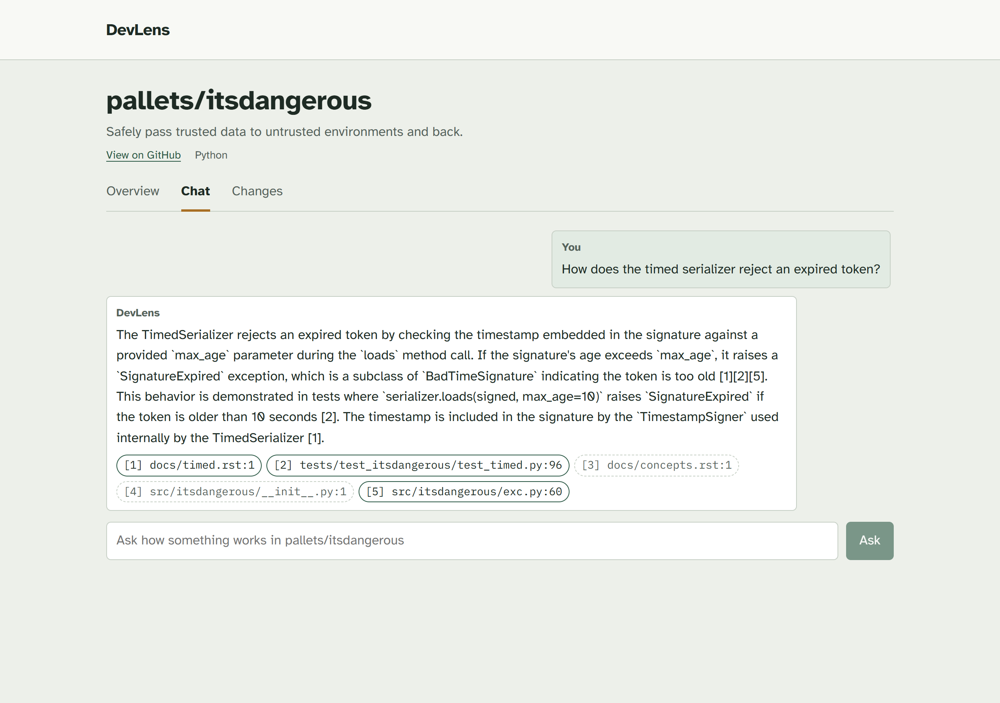
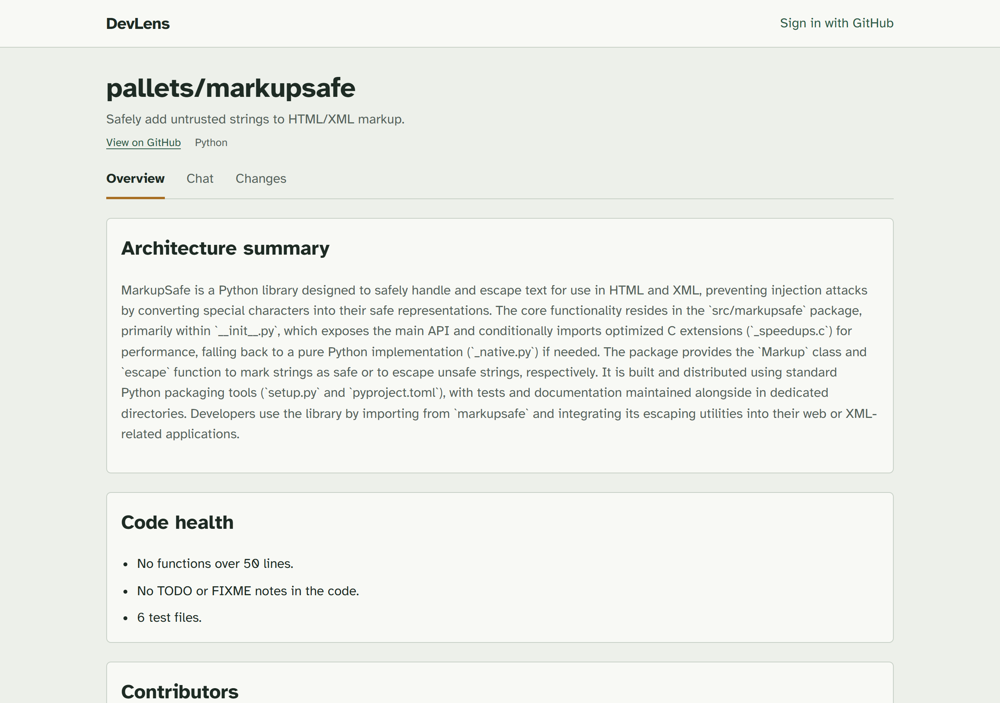
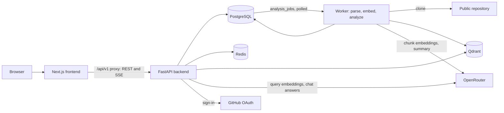

#  DevLens

DevLens reads a public GitHub repository and answers questions about its code. Each answer cites
the files and lines it was built from. For each analyzed commit it shows what changed, which files
import the changed code, and any security-sensitive lines that were added or removed. The same
change analysis also runs as a GitHub Action that comments on every pull request.



**Live demo.** DevLens runs as a private alpha on a single AWS instance that is started on request.
[aimunna.me/devlens-fullstack](https://aimunna.me/devlens-fullstack/) explains how to get a demo
window and an access key. Chat also asks you to sign in with GitHub.

## What it does

Paste a repository URL on the home page. While it is analyzed, a progress view walks through each
step with live file and chunk counts. Then the repository has its own page at `/r/<owner>/<repo>`
with three tabs.

**Chat.** Ask how something works. Up to six retrieved code sections go to the model, numbered
`[1]` to `[6]`. The answer cites them inline, and each source is listed under the answer as
`file:line`; both open the exact lines on GitHub at the analyzed commit, and sources the model saw
but did not cite are drawn dashed. Answers render as Markdown (lists, code blocks). Follow-up
questions see the previous three turns, questions about the whole repository ("what are the main
components?") start from the README, and earlier chats are listed beside the conversation. You can
stop an answer mid-stream or copy it.

**Overview.** An architecture summary written from the README, the package manifest, and the
entry-point code. Code health is reported as facts, not a score: functions over 50 lines, each
linked to its lines on GitHub at the analyzed commit, plus TODO and FIXME notes and test files.
Hotspots are the code files that changed most in the past year times the files importing them:
where a change is both likely and far-reaching. The analysis fetches that year of history itself.
The tab also shows the language mix, contributors, the file tree, and an import explorer: one file
in the middle, what imports it on one side, what it imports on the other; choose any neighbor to
move to it. Signed in, **Share** makes a read-only link to the Overview that opens without a
sign-in for 7 days (`SHARE_TOKEN_TTL_DAYS`); Stop sharing turns it off. The interface is light by
default; the moon button in the header switches to dark, and the browser remembers the choice.

**Changes.** An analyzed commit against its parent; pick any commit DevLens has analyzed. Each
changed file opens to its diff with line numbers, and lines touching auth, tokens, secrets, crypto,
or environment config are marked with what they touch. Files are ranked high, medium, or low:
secrets and credentials are high, and so is removing an auth or token check. Docs and stylesheets
are never flagged, and test files stay low because their fixtures name tokens and passwords all
the time. The files that import the changes are drawn as rings, one ring per import step.
The import graph follows Python packages, relative imports, `src/` layouts, and TypeScript path
aliases. You can ask questions about the diff itself. A reference to a variable, such as
`${JWT_SECRET}` or `process.env.API_KEY`, counts as environment config, not as a secret.

**Pull request comments.** The same analysis runs as a GitHub Action, with no server and nothing to
install. On each pull request it posts one comment, updated on every push. First come removed
checks: auth decorators and dependencies, permission checks and 401/403 responses, CSRF
protection, input validation, and rate limits, each linked to the line it was on. A check that
reappears elsewhere in the same pull request counts as moved, not removed. Then the comment lists
the security-sensitive changes by severity, deleted files that something still imports, the
tests to run, suggested reviewers, and the files that import the changes, one import step at a
time. It compares the pull request with the commit it branched from, as GitHub's "Files changed"
does.

The tests to run are the test files that import a changed file, directly or through other files;
changed files that no test imports are listed too. That shows a test loads the code, not how well
it tests it. Suggested reviewers are the people who changed the most of these files in the past
year, not counting the pull request's own authors or bots. They are linked, not @-mentioned, so no
one is notified. Someone who committed under several emails can be merged into one with a
`.mailmap`.

```yaml
# .github/workflows/pr-risk.yml
on: pull_request
permissions:
  contents: read
  pull-requests: write
jobs:
  report:
    runs-on: ubuntu-latest
    steps:
      - uses: actions/checkout@v4
        with:
          fetch-depth: 0   # the full history, to find where the branch started
      - uses: atikulmunna/devlens-fullstack/pr-risk@main
```

A pull request from a fork gets a read-only token, so the report goes to the job summary instead.
Run it locally with `python pr-risk/pr_risk.py --base main --head HEAD`.



## How it works



- **Analysis** runs in one Python worker process that polls the `analysis_jobs` table and takes
  each job through three stages:
  1. *Parse*: a shallow clone, tree-sitter chunks that keep functions and classes whole (up to
     120 lines each), the commit diff against its parent, and code health measured on whole files.
     It also fetches the past year of history to count how often each file changed, for hotspots;
     that step is best-effort, like the commit diff, and never fails the analysis.
  2. *Embed*: chunk embeddings through OpenRouter (`openai/text-embedding-3-small`) into Qdrant.
  3. *Analyze*: the architecture summary (`openai/gpt-4.1-mini`), the language breakdown, and
     contributors from the GitHub API.

  Run exactly one worker. Jobs are claimed without a lease, so a second worker would process the
  same job twice.
- **Retrieval** combines Qdrant vector search with PostgreSQL full-text search. Test files and CI
  config are ranked lower unless the question is about them, because they restate the code they
  surround. Answers stream to the browser over Server-Sent Events.
- **Sign-in** uses GitHub OAuth. The backend sets an HttpOnly refresh cookie that rotates on every
  use, plus a CSRF cookie; the frontend keeps the access token in memory only and renews it on a
  401. The frontend proxies `/api/v1`, so these cookies stay first-party.
- **OpenRouter** is the only external AI service. Without a key, search and chat do not work.
- **Pull request comments** run in the repository's own CI, not on the DevLens server. The Action
  in `pr-risk/` loads the import graph, the diff scan, and the severity rules from `backend/` and
  `workers/`. Those modules use only the Python standard library, so the runner installs nothing,
  and no AI service is involved.

Stack: Python 3.12, FastAPI, SQLAlchemy and Alembic, PostgreSQL 16, Redis, Qdrant, Next.js 14 with
TypeScript, Docker Compose. The frontend's API types are generated from the backend's OpenAPI
schema, so a breaking backend change fails the frontend typecheck.

## Evaluation

The ranking and model choices were measured rather than assumed.

- **Retrieval.** On a 25-question golden set where each question lists the files that answer it,
  a chunk from the right file reaches the top 5 for 88% of questions (MRR 0.80). Ranking test files
  lower raised that from 84%. A cross-encoder reranker was measured too and left off: no gain in
  recall, about a second more per query, and a 3 GB image instead of 330 MB.
  [Details](docs/evaluation/Retrieval_Eval.md).
- **Models.** Chat and summary models were compared in blind-graded rounds on real retrieval,
  including DevLens's own code, which no model could have seen in training. `openai/gpt-4.1-mini`
  scored best in every graded round, at under a tenth of a cent per answer.
  [Details](docs/evaluation/Model_Selection.md).

## Run it locally

You need Docker with Compose, Node.js 20 (for the frontend checks), an
[OpenRouter](https://openrouter.ai) API key, and a GitHub OAuth app whose callback URL is
`http://localhost:8000/api/v1/auth/callback`.

```powershell
git clone https://github.com/atikulmunna/devlens-fullstack.git
cd devlens-fullstack
Copy-Item backend/.env.example backend/.env
Copy-Item workers/.env.example workers/.env
Copy-Item frontend-next/.env.example frontend-next/.env
```

In `backend/.env`, set `OPENROUTER_API_KEY`, `GITHUB_CLIENT_ID`, `GITHUB_CLIENT_SECRET`, and
`JWT_SECRET` (any long random string). In `workers/.env`, set `OPENROUTER_API_KEY`. Then:

```powershell
./scripts/dev-up.ps1       # bash scripts/dev-up.sh on macOS or Linux
./scripts/db-migrate.ps1   # bash scripts/db-migrate.sh
```

Open <http://localhost:3000> and analyze a small repository such as `pallets/itsdangerous`. The
backend's interactive API docs are at <http://localhost:8000/docs>.

The first build is slow: by default the backend image also installs PyTorch for the optional
reranker. To skip it, build the backend with
`docker compose build --build-arg INSTALL_RERANKER=false backend` before starting.

## Configuration

Every setting is listed with its default in `backend/.env.example` and `workers/.env.example`.
The ones you are most likely to change:

| Setting | Service | Default | Notes |
|---|---|---|---|
| `OPENROUTER_API_KEY` | backend, workers | none | Embeddings, chat answers, summaries |
| `LLM_CHAT_MODEL` | backend | `openai/gpt-4.1-mini` | Any OpenRouter chat model |
| `LLM_SUMMARY_MODEL` | workers | `openai/gpt-4.1-mini` | Writes the architecture summary |
| `EMBED_MODEL` | backend, workers | `openai/text-embedding-3-small` | Must match in both. A model with a different vector size recreates the collection; re-analyze every repository afterwards |
| `FRONTEND_URL` | backend | `http://localhost:3000` | Where people open the app; sign-in returns there |
| `RATE_LIMIT_GUEST_PER_WINDOW`, `RATE_LIMIT_AUTH_PER_WINDOW` | backend | 10, 50 per hour | Applies to analyses, chat requests, and diff questions |
| `PARSE_MAX_FILES`, `PARSE_MAX_CHUNKS` | workers | 8000, 20000 | Larger repositories stop with a message saying which limit they hit |
| `RERANKER_ENABLED` | backend | `false` | Needs an image built with `INSTALL_RERANKER=true` |

## Development

The backend and worker code is baked into their images, so rebuild after a change
(`docker compose build backend worker`), then:

```powershell
./scripts/test-backend.ps1
./scripts/test-worker.ps1
npm --prefix frontend-next test
python -m pytest pr-risk/tests   # the pull request Action; needs only pytest and git
```

CI also fails on lint, formatting, or type errors. Python rules are in `ruff.toml`:

```powershell
pip install ruff==0.12.4
ruff check .
ruff format --check .
npm --prefix frontend-next run lint
npm --prefix frontend-next run typecheck
```

After changing an endpoint or a response model, regenerate the frontend's API types and commit
both files (CI checks that they are current):

```powershell
docker compose exec -T -e PYTHONPATH=/app backend python - < scripts/export_openapi.py > frontend-next/lib/openapi.json
npm --prefix frontend-next run gen:api
```

`scripts/smoke-e2e.ps1` runs an analysis end to end against a running stack, and
`scripts/eval_retrieval.py` reruns the retrieval evaluation (see its docstring).

| Path | Contents |
|---|---|
| `backend/` | FastAPI app: routers in `app/api/v1`, logic in `app/services`, Alembic migrations |
| `workers/` | The parse, embed, and analyze stages |
| `frontend-next/` | The Next.js app |
| `pr-risk/` | The pull request Action: `action.yml`, the report, and its tests |
| `deploy/` | Production pieces: Caddyfile, access-key page, provisioning script, runbook |
| `docs/` | API contract, architecture decision record, evaluation reports and datasets |
| `scripts/` | Dev, test, migration, and evaluation helpers |

## Deployment

The demo runs the whole stack on one EC2 instance with `docker-compose.prod.yml`. Caddy serves it
over HTTPS with a Let's Encrypt certificate for an sslip.io hostname, and an access-key page gates
the whole site except share links; chat still needs a GitHub sign-in behind it. The runbook,
[`deploy/aws.md`](deploy/aws.md), covers provisioning, first boot, updates, backups, and teardown.
When updating, run the migrations before the new worker starts; the runbook gives the order. The
instance accepts no SSH: it is reached through AWS Systems Manager, and `deploy/remote.sh` runs a
command on it.

## API

Everything is under `/api/v1`. The full contract is in
[`docs/api/API_Contract_v1.1.md`](docs/api/API_Contract_v1.1.md).

| Area | Endpoints |
|---|---|
| Repositories | `POST /repos/analyze`, `GET /repos/{id}/status` (SSE), `GET /repos/{id}/dashboard`, `GET /repos/by-name/{owner}/{name}`, `GET /repos/recent`, `GET /repos/{id}/dependency-graph`, `GET /repos/{id}/hotspots` |
| Chat | `POST /chat/sessions`, `GET /chat/sessions`, `GET /chat/sessions/{id}`, `POST /chat/sessions/{id}/message` (SSE), `GET /chat/repos/{id}/suggestions` |
| Commit diff | `GET /repos/{id}/diffs`, `GET /repos/{id}/diff`, `POST /repos/{id}/diff/ask` (SSE) |
| Auth | `GET /auth/github`, `GET /auth/callback`, `POST /auth/refresh`, `GET /auth/me`, `DELETE /auth/logout` |
| Sharing | `POST /export/{repo_id}/share`, `GET /share/{token}`, `DELETE /export/share/{share_id}` |

Chat, diff, and session endpoints need a signed-in user. Streaming endpoints send `delta` events
with answer tokens and a final `done` event; for chat, `done` carries the numbered citations.

## Troubleshooting

- **Sign-in does not stick.** `FRONTEND_URL` must be the exact address in your browser, and
  `GITHUB_OAUTH_REDIRECT_URI` must match the callback URL registered in the GitHub OAuth app.
- **An analysis stays queued.** Check that the worker is running: `docker compose logs -f worker`.
- **Search or chat fails with a 502.** The backend cannot reach OpenRouter; check
  `OPENROUTER_API_KEY` in `backend/.env`. Query embeddings need it even when the model is fine.
- **Answers ignore recent code.** Answers come from the commit that was analyzed. Analyze the
  repository again to pick up newer commits.

## License

MIT, see [`LICENSE`](LICENSE).
